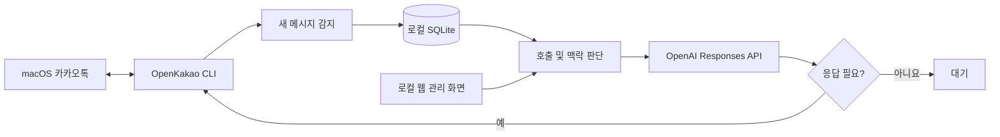

# Kakao Group Assistant

**카카오톡 단톡방에 상주하는 맥락 기반 AI 어시스턴트**

macOS 카카오톡의 대화를 읽고, 필요할 때만 답하는 개인용 AI 어시스턴트입니다. 별도 카카오톡 서버나 비공식 네트워크 프로토콜을 구현하지 않고, [OpenKakao CLI](https://github.com/JungHoonGhae/openkakao-cli)와 OpenAI Responses API를 사용합니다. 카카오의 공식 제품은 아닙니다.

## 주요 기능

- **명시적 호출**: `AI야`, `@AI`, `GPT야` 등의 호칭에 반응합니다.
- **자율 참여**: 일반 대화는 잠시 기다린 뒤 도움이 되는 내용이 있을 때만 참여합니다.
- **후속 질문**: 직전 AI 답변의 맥락을 활용해 다른 참가자의 이어지는 질문도 판단합니다.
- **대화 메모리**: 최근 24시간, 최대 2,000건을 로컬 SQLite에 유지하며 기본적으로 최근 2시간 내 최대 100건을 모델에 제공합니다.
- **웹 관리 화면**: 탐지 간격, 대기 시간, 맥락 범위, 응답 지침, 전송 여부 등을 편집하고 예시 대화로 테스트할 수 있습니다.
- **요약 모드**: 필요하면 주기적 중요 대화 요약, 주제 분류 등으로 전환할 수 있습니다.

## 동작 구조



## 시작하기

### 요구 사항

- macOS 및 로그인된 카카오톡 데스크톱 앱
- Python 3.10 이상 (별도 Python 패키지 설치 불필요)
- [OpenKakao CLI](https://github.com/JungHoonGhae/openkakao-cli) 설치 및 해당 도구의 문서에 따른 권한 설정
- OpenAI API 키와 Responses API의 구조화된 출력을 지원하는 모델

### 실행

```sh
git clone https://github.com/sthasq/kakao-group-assistant.git
cd kakao-group-assistant

export KAKAO_ROOM="대상 단톡방 이름"
export OPENKAKAO_CLI="$HOME/.local/bin/openkakao-cli"
export OPENAI_MODEL="gpt-6-luna"
export OPENAI_REASONING_EFFORT="low"
# 키를 셸 기록이나 저장소에 남기지 않고 입력 (zsh)
read -s "OPENAI_API_KEY?OpenAI API key: "
export OPENAI_API_KEY
python3 -B server.py
```

모델 이름은 본인의 API 계정에서 사용할 수 있는 모델로 지정하세요. 키를 환경 변수 대신 macOS 키체인에 저장한 경우, `OPENAI_KEYCHAIN_SERVICE` 및 `OPENAI_KEYCHAIN_ACCOUNT`를 지정할 수도 있습니다.

브라우저에서 [http://127.0.0.1:8765](http://127.0.0.1:8765)를 열고:

1. **설정**에서 예시 대화 테스트를 실행합니다.
2. 카카오톡에서 대상 단톡방을 엽니다.
3. 처음에는 브라우저에만 결과를 표시하는 모드로 확인합니다.
4. 방 참가자에게 AI 사용 및 데이터 처리에 대해 안내하고 동의를 얻은 후, 실제로 단톡방에 답변을 보내려면 전송 옵션을 켜고 저장합니다.
5. 어시스턴트를 켜면 가동됩니다. 중지하려면 관리 화면에서 일시 정지하거나 터미널에서 Ctrl+C를 누릅니다.

## 동작 예시

> 참가자 A: AI야, 17 곱하기 23이 얼마야?  
> AI 어시스턴트: 391입니다.  
> 참가자 B: 그럼 거기에 9를 더하면?  
> AI 어시스턴트: 400입니다.

일반 대화에 응답할 이유가 없으면 메시지를 보내지 않습니다. 답변에는 `[AI 어시스턴트]` 표시가 붙습니다.

## 제한 사항과 개인정보

- 카카오톡의 화면 접근성에 의존하므로 카카오톡이 닫히거나 화면이 잠기면 읽기·전송이 실패할 수 있습니다. 실제 탐지 간격은 CLI의 처리 시간에 따라 달라집니다.
- 새 메시지가 없는 경우 API를 호출하지 않지만, 일반 대화 참여 여부를 판단하는 API 요청에는 비용이 발생할 수 있습니다.
- 재시작 시 기존 메시지를 기준값으로 삼으며 지난 대화를 자동으로 재답변하지 않습니다. 접근성 화면에서 보이지 않았던 메시지는 누락될 수 있습니다.
- 전송 확인 실패 시 자동 재전송하지 않습니다. 카카오톡에 별도 스레드, 첨부 분석, 웹 검색, 외부 작업 기능은 구현되어 있지 않습니다.
- 단톡방에서 읽은 텍스트와 이전 응답은 로컬 `.runtime/`에 저장되며 필요한 최근 문맥은 OpenAI API에 전달됩니다. 로컬 메시지의 보존 한도는 실행 중 정리되는 논리적 레코드를 기준으로 합니다(보안 삭제를 보장하지 않습니다).
- API 키와 대화 기록은 저장소에 포함하지 않습니다. `.runtime/`과 개인 설정을 공유하거나 공개하지 마세요.
- 웹 관리 화면은 로컬 호스트에만 연결됩니다. 외부 네트워크에 노출하지 마세요.
- 사용 전 서비스 이용 조건 및 관련 개인정보 보호 의무를 확인하세요.

## 구성

| 파일 | 역할 |
| --- | --- |
| `server.py` | 실시간 감지, 메시지 처리, 전송, 로컬 웹 서버 |
| `decisions.py` | Responses API, 구조화된 응답, 판단 지침 |
| `chat_memory.py` | SQLite 대화 메모리 |
| `index.html`, `app.js`, `settings.js`, `style.css` | 웹 관리 화면 |

## 오프라인 테스트

```sh
python3 -B -m unittest discover -s tests -v
```

